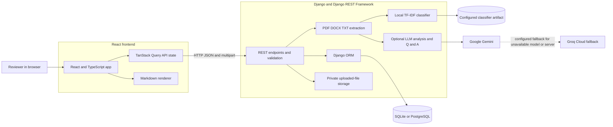
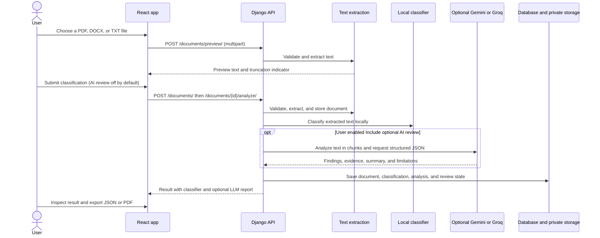
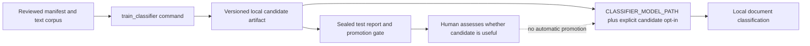

# DocuGuard AI

DocuGuard AI is a local-first, shared workspace for classifying business documents and deciding which ones need a closer human review. It accepts PDF, DOCX, and TXT files, extracts their text on the Django server, and runs a configured TF-IDF classifier locally. LLM use is optional: turn it on for a one-off document review, or open **Ask AI** to ask questions about a stored document or a general topic.

This is a showcase project. It is not a legal adviser, compliance certification tool, calibrated measure of harm, or production-ready multi-user service. Verify model output against the source document.

## What it does

- Upload and preview PDF, DOCX, and TXT files, with server-side type and size validation.
- Classify extracted text into Low, Medium, or High review priority when a classifier artifact is configured.
- Show class scores, influential terms, and similar training examples as model explanations. These are signals, not evidence or probabilities of harm.
- Route high-priority, uncertain, and showcase-candidate predictions to a manual-review queue.
- Optionally request a structured LLM document review with evidence excerpts, explanations, recommended actions, and limitations.
- Use **Ask AI** for a non-persisted conversation, with optional context from a stored document. Replies support Markdown, including tables and code blocks.
- View database-backed dashboard metrics, history, reviewer decisions, and the configured classifier's evaluation report.
- Export document analysis results as JSON or PDF; switch between light and dark themes.

## Architecture



The browser never receives provider API keys. The Django API validates uploads, stores documents and results, and calls the local classifier. Only an explicit LLM review or an Ask AI submission sends document text to a configured provider.

### Main document workflow



### Ask AI workflow

1. Open **Ask AI** and choose either no document or a stored document. Search by filename to find older uploads.
2. Choose a configured model, type a question, and submit it. Nothing is sent to an LLM before submission.
3. The API loads the selected document's extracted text, treats it as untrusted context, calls the selected provider, and returns the answer and actual model used.
4. The frontend renders the answer as Markdown. Conversation history stays in the current browser view and is not saved to the database.

If Gemini reports an unavailable model (HTTP 404) or a server error (HTTP 5xx), the API can retry with the configured Groq fallback. It does not silently switch for authorization errors, quotas, timeouts, or network failures.

### Human-review workflow

Classifier predictions remain immutable when a reviewer marks a queue item as reviewed or dismissed. The human decision, final human-assessed priority, and note are stored separately. This shared workspace has no accounts, so it cannot verify who made a decision.

## Technology and project layout

- **Frontend:** React, Vite, TypeScript, Tailwind CSS, React Router, TanStack Query, Recharts, Lucide, `react-markdown`, and `remark-gfm`.
- **Backend:** Django, Django REST Framework, Django ORM, SQLite by default, PostgreSQL through `DATABASE_URL`.
- **Extraction:** PyMuPDF for PDF, `python-docx` for DOCX, Python's standard library for TXT.
- **AI providers:** Google Gemini SDK and the OpenAI-compatible Python client for Groq Cloud.
- **Classifier:** scikit-learn TF-IDF features and a trained classifier artifact loaded by the Django service.

```text
.
??? backend/
?   ??? apps/core/                 # Models, serializers, API views, extraction, AI, classifier
?   ??? config/                    # Django settings and URL configuration
?   ??? model_artifacts/           # Local generated artifacts; ignored by Git
?   ??? private_uploads/           # Local uploaded files; ignored by Git
?   ??? manage.py
?   ??? requirements.txt
?   ??? .env.example
??? data/
?   ??? docuguard_corpus_v0.1/     # Showcase corpus, manifests, and original formats
?   ??? classifier_corpus/         # Training instructions, template, draft examples
??? docs/classifier/               # Rubric, training guide, candidate evaluation report
??? frontend/src/                  # React pages, API client, components, and styles
??? docker-compose.yml              # Optional local PostgreSQL/Django/Vite environment
??? README.md
??? UPGRADE_PLAN.md                 # Classifier upgrade phases and status
```

The workspace navigation includes **Overview**, **New analysis**, **Ask AI**, **Document history**, **Flagged review**, **Model performance**, and **Settings**. Classification is the standard local workflow; LLM use is a user action rather than a prerequisite.

The main backend responsibilities are `apps/core/views.py` (REST workflows), `serializers.py` (API representation), `models.py` (documents, analyses, classifier outputs, and review decisions), `extraction.py` (file parsing), `classifier_service.py` (artifact loading and inference), `classifier_training.py` (candidate training and evaluation), and `services.py` (Gemini/Groq calls and structured LLM reports). On the frontend, `src/api.ts` is the fetch boundary, `src/App.tsx` owns routes and workspace pages, and `src/pages/` and `src/components/` contain feature views and reusable UI.

## Requirements

- Python 3.11 or newer; the project has been run with Python 3.12.
- Node.js 20 or newer and npm.
- Gemini and/or Groq API credentials only if you want to use Ask AI or request an LLM document review. Upload and local classification do not require provider credentials.
- Docker Desktop only if you want the optional Docker Compose setup.

## Run locally

### Windows PowerShell

From the repository root, create a virtual environment and install Python dependencies:

```powershell
py -3.12 -m venv .venv
.\.venv\Scripts\Activate.ps1
python -m pip install -r backend\requirements.txt
Copy-Item backend\.env.example backend\.env
Copy-Item frontend\.env.example frontend\.env
```

Edit `backend/.env` before starting the server:

- Set a unique `DJANGO_SECRET_KEY` for your local environment.
- Configure one or both AI provider keys if you intend to use LLM features. If you want local-only use, leave `GEMINI_API_KEY` and `GROQ_API_KEY` blank instead of keeping the example placeholder values.
- Set `CLASSIFIER_MODEL_PATH` and `CLASSIFIER_ALLOW_CANDIDATE=true` if you have trained and want to load the showcase classifier artifact.

Start Django in one terminal:

```powershell
Set-Location backend
..\.venv\Scripts\python.exe manage.py migrate
..\.venv\Scripts\python.exe manage.py runserver 127.0.0.1:8000
```

Start Vite in another terminal:

```powershell
Set-Location frontend
npm install
npm run dev
```

Open [http://localhost:5173](http://localhost:5173). The Vite API URL defaults to `http://localhost:8000/api` in `frontend/.env.example`.

If port 8000 is occupied on your machine, run Django on another port and point Vite at it. For example, from the `backend` directory:

```powershell
..\.venv\Scripts\python.exe manage.py runserver 127.0.0.1:8001
```

Then set the public frontend setting in `frontend/.env` and restart Vite:

```env
VITE_API_URL=http://localhost:8001/api
```

Do not put provider keys in frontend environment variables. Anything prefixed with `VITE_` is public browser configuration.

### Linux and macOS

From the repository root:

```bash
python3 -m venv .venv
source .venv/bin/activate
python -m pip install -r backend/requirements.txt
cp backend/.env.example backend/.env
cp frontend/.env.example frontend/.env
```

Configure `backend/.env`, then run Django from `backend/`:

```bash
cd backend
../.venv/bin/python manage.py migrate
../.venv/bin/python manage.py runserver 127.0.0.1:8000
```

In a second terminal, run the frontend:

```bash
cd frontend
npm install
npm run dev
```

### Optional Docker Compose

Docker Compose starts PostgreSQL, Django, and Vite. It is not required for local development.

```powershell
Copy-Item backend\.env.example backend\.env
# Edit backend/.env and set DJANGO_SECRET_KEY and any provider keys.
docker compose up --build
```

The Compose database password is a development-only value. Do not reuse it in a deployment. Stop the services with `Ctrl+C`; `docker compose down` stops the stack, while `docker compose down -v` also deletes its database and upload volumes.

## Environment configuration

`backend/.env.example` documents the backend settings:

| Setting | Purpose |
| --- | --- |
| `DJANGO_SECRET_KEY`, `DJANGO_DEBUG`, `DJANGO_ALLOWED_HOSTS` | Django environment and host settings |
| `DATABASE_URL` | Database connection; defaults in the Django settings to local SQLite when omitted |
| `FRONTEND_ORIGIN` | Allowed browser origin for CORS, normally `http://localhost:5173` |
| `MAX_UPLOAD_MB` | Maximum upload size; default is 20 MB |
| `MAX_DOCUMENT_CHARS` | Maximum extracted document length accepted by the LLM analysis service; default is 500,000 characters |
| `GEMINI_API_KEY`, `GEMINI_DEFAULT_MODEL`, `GEMINI_MODELS`, `GEMINI_TIMEOUT_SECONDS` | Gemini credentials, allowed models, and timeout |
| `GROQ_API_KEY`, `GROQ_BASE_URL`, `GROQ_DEFAULT_MODEL`, `GROQ_MODELS`, `GROQ_FALLBACK_MODEL`, `GROQ_TIMEOUT_SECONDS` | Groq Cloud credentials, OpenAI-compatible API URL, models, and fallback |
| `CLASSIFIER_MODEL_PATH` | Path to a trained local `model.joblib`; blank disables local predictions |
| `CLASSIFIER_ALLOW_CANDIDATE` | Explicitly permits a non-approved showcase candidate to serve predictions |
| `CLASSIFIER_MIN_WORDS` | Minimum extracted words required for classifier inference |

`frontend/.env.example` contains only `VITE_API_URL`, the public base URL for the Django API. Never add secrets to frontend configuration.

### Configure a provider

Create a key in [Google AI Studio](https://aistudio.google.com/apikey) and/or [Groq Console](https://console.groq.com/keys). Add it to `backend/.env` and restart Django. The Settings page reports whether a key is configured without returning its value; it does not test live model availability. Model IDs and access depend on your provider account. The Groq API uses `https://api.groq.com/openai/v1` by default.

The selected model is not silently replaced after ordinary errors. Gemini model-not-found and server errors can use the configured Groq fallback. If the fallback is not configured or also fails, the API returns an actionable error and does not fabricate an analysis.

### Train and enable the showcase classifier

The checked-in showcase data is AI-assisted and owner-approved in aggregate. It is not independently dual-human reviewed, production approved, or suitable for production performance claims. Training produces a candidate; it does not promote a production model. Read [the classifier training guide](docs/classifier/training.md) and [the candidate report](docs/classifier/showcase_candidate_report.md) before training or enabling it.



From the repository root in PowerShell:

```powershell
.\.venv\Scripts\python.exe backend\manage.py train_classifier `
  --manifest data\docuguard_corpus_v0.1\manifest_showcase_approved.csv `
  --output-dir backend\model_artifacts\candidates `
  --code-version showcase-local `
  --allow-showcase-owner-approval `
  --calibrate-for-review
```

Set `CLASSIFIER_MODEL_PATH` to the resulting `model.joblib` path in `backend/.env` and explicitly set `CLASSIFIER_ALLOW_CANDIDATE=true`. Restart Django after changing the artifact path. Candidate predictions are sent to manual review. The generated artifacts are ignored by Git and are not included when someone clones the repository.

## API overview

All routes are mounted below `/api/`. Endpoints are public and shared; there are no accounts or per-user ownership controls. Paginated list endpoints use Django REST Framework's page-number pagination.

| Method | Endpoint | Description |
| --- | --- | --- |
| `GET` | `/api/health/` | Health check (`{"status":"ok"}`) |
| `GET` | `/api/settings/` | Workspace settings, configured model IDs, provider-key presence, upload limit, and classifier status |
| `PATCH` | `/api/settings/` | Update default model and theme |
| `GET` | `/api/dashboard/` | Database-backed metrics, recent analyses, activity, and review decisions |
| `GET` | `/api/model-performance/` | Evaluation and promotion-gate information for the configured artifact |
| `GET` | `/api/documents/` | List documents; supports filename `search` |
| `POST` | `/api/documents/preview/` | Validate and extract a temporary upload preview (multipart field `file`); does not store the upload |
| `POST` | `/api/documents/` | Validate, extract, and store an uploaded document (multipart field `file`) |
| `GET` | `/api/documents/{id}/` | Read one shared document and latest result metadata |
| `DELETE` | `/api/documents/{id}/` | Delete a document and its associated records and stored file |
| `POST` | `/api/documents/{id}/analyze/` | Classify locally; optionally send `{"include_ai": true, "model": "..."}` for an LLM report. LLM is off by default. |
| `POST` | `/api/ask-ai/` | Ask an optional question with `question`, optional `document_id`, configured `model`, and optional short `history` |
| `GET` | `/api/analyses/` | Paginated history; supports `search`, `priority`, `type`, `model`, `start`, `end`, and `ordering` |
| `GET` | `/api/analyses/{id}/` | Read one analysis and its classifier result |
| `GET` | `/api/analyses/{id}/export/json/` | Download a JSON report |
| `GET` | `/api/analyses/{id}/export/pdf/` | Download a PDF report |
| `DELETE` | `/api/analyses/{id}/delete/` | Delete an analysis and its associated document/file |
| `GET` | `/api/reviews/` | Paginated manual-review queue; supports status, priority, score band, reason, dates, and ordering filters |
| `POST` | `/api/reviews/{classification_id}/decision/` | Save review status, final human-assessed class, and note separately from the model prediction |

Example Ask AI request:

```json
{
  "question": "When can either party terminate this agreement?",
  "document_id": 12,
  "model": "gemini-3.8-flash",
  "history": []
}
```

The response contains the answer, the model actually used (including fallback), and the selected document name. Ask AI conversation history is not persisted.

## Tests and builds

Run the backend tests from `backend/`:

```powershell
..\.venv\Scripts\python.exe -m pytest
```

Or on Linux/macOS:

```bash
../.venv/bin/python -m pytest
```

Run frontend tests, type-check/build, and lint from `frontend/`:

```bash
npm test
npm run build
npm run lint
```

Provider calls are mocked in automated tests; the normal test suite does not need paid provider access. Do not put live provider keys in test fixtures.

## Security, privacy, and data retention

- **Shared workspace:** The app intentionally has no authentication. Anyone who can reach the API can inspect, upload, classify, export, or delete shared workspace records. Keep it on a trusted local or private network; it is not suitable for direct public exposure.
- **Provider privacy:** Classification is local. An LLM receives document text only when `include_ai` is explicitly enabled or when a user submits an Ask AI request with a document selected. Check the provider's terms before sending sensitive material.
- **Private uploads:** Files are stored under `backend/private_uploads/` and are not exposed as public media URLs. The file parser extracts text; uploaded files are not executed.
- **Retention:** Uploaded files and extracted text remain until the document or associated analysis is deleted. Automatic expiry is not implemented. Ask AI conversation turns are not stored in the database.
- **Secrets:** `.env` files are ignored by Git. Keep provider keys server-side and use a unique Django secret outside local development.
- **Untrusted model output:** LLM findings are validated before persistence and rendered as text/Markdown. The Ask AI Markdown renderer does not enable raw HTML. Treat all model output as unverified.

For a real deployment, add authentication and per-user access control, serve over HTTPS, set `DJANGO_DEBUG=false`, configure restrictive `DJANGO_ALLOWED_HOSTS` and `FRONTEND_ORIGIN`, use a managed PostgreSQL database, and configure protected file storage and static-file serving. `collectstatic` writes to `backend/staticfiles/`. Deployment has not been performed or verified.

## Known limitations

- OCR is not included. Scanned PDFs without extractable text return unable-to-assess rather than an invented priority.
- LLM analysis accepts extracted text up to `MAX_DOCUMENT_CHARS`; it processes long inputs sequentially in chunks and consolidates the section reports. Inputs over the configured limit fail explicitly instead of silently analyzing only a prefix.
- Ask AI sends the selected document's extracted text as context. Very long text may exceed the selected provider's context limits; the API reports provider errors rather than silently truncating it.
- Classifier scores are model scores, not calibrated harm probabilities. The showcase corpus is synthetic-heavy and AI-assisted, and its evaluation currently fails the conservative release gate. Candidate results require human review.
- The shared no-login workspace cannot identify reviewers or guarantee that a recorded review came from a particular person.
- Current Docker Compose configuration is for local development. No production deployment or production security review has been completed.
